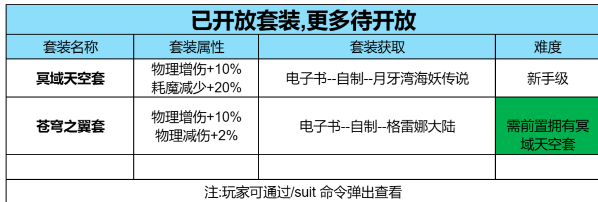

套装系统
魔力套装为附魔形式,任意装备混合皆可形成套装,只需要满足收集对应的套装属性石附魔到装备即可

========================================================================

比如玩家现在穿了一套弑神装备，那么玩家只需要完成电子书--自制--月牙湾海妖传说的副本:惊龙归墟

收集齐全附魔石后按要求打入装备上后穿戴，即可激活套装属性：

========================================================================

